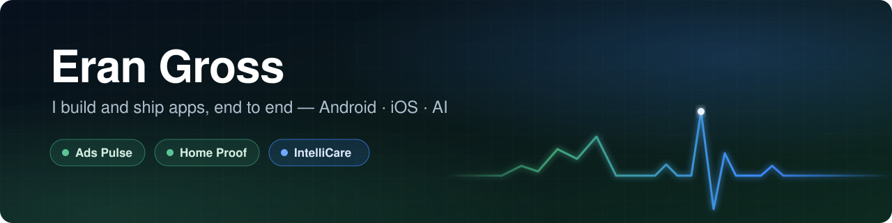

  

  
  
  
  

### 👋 Hi, I'm Eran

I design, build and ship my own products end to end — the app, the store page, the screenshots, the languages and every release.

 

## 🚀 What I've built

| | **Ads Pulse** | **Home Proof** | **IntelliCare** |
|---|---|---|---|
| **What it is** | Your ChatGPT Ads account on your phone | Your home's records and proof | Patient management system based on Claude AI |
| **Platforms** | Android | Android · iPhone & iPad in development | Web · iOS · Android |
| **Status** | ✅ Live on Google Play | ✅ Live on Google Play | 🧪 Public code |
| **Languages** | 10 | 19 | — |
| **Built with** | Kotlin · Jetpack Compose | Kotlin · Jetpack Compose · Room · Swift · SwiftUI | Node.js · React · MongoDB · Claude · Expo |

 

---

<h2>
  
  Ads Pulse
</h2>

**Your ChatGPT Ads account, in your pocket.** Live numbers, charts and alerts for every campaign, ad group and ad — and the controls to change them. Nothing changes without your confirmation.

  
  
  
  
  

📊 Live numbers and charts · 🔎 Account → campaign → ad group → ad · ✏️ Pause, budgets, bids, ad text · ➕ Create campaigns and ads · 🎯 Conversions · 🔔 Click and conversion alerts · 👥 Audiences and product feeds · 🔐 App lock · 🌍 10 languages

  
  

 

---

<h2>
  
  Home Proof
</h2>

**Document your home once, and have the proof ready when you need it.** Rooms, items, serial numbers, receipts and documents — dated, organized, and ready to share as a clear report when the insurer, the landlord or the buyer asks.

  
  
  
  

🏠 Room by room · 🧾 Receipts and prices · 📋 Insurance claim loss list · 🔑 Signed move-in / move-out reports · 📄 PDF reports · 🔗 Evidence chain · 🛠️ Maintenance plan · 🔄 Encrypted household sync · 💾 Encrypted backups · 🔒 No account, no ads · 🌍 19 languages

  
  
  

 

---

<h2>
  
  IntelliCare
</h2>

**A patient management system based on Claude AI.** Patient records, appointments, clinical documents, billing and insurance, and patient messaging in one system — and Claude AI runs all of it from plain language: find a patient, answer from the chart, check drug safety, book the visit and write the paperwork.

🤖 3,600+ agent functions · 🗂️ 884 medical collections · 🩺 36 specialties · 📄 ~900 document templates · 💊 Drug-safety checks · 🎙️ Voice rounds and visit → SOAP notes · 📱 Native iPhone and Android app

  
  

 

---

## 🧰 What I build with

  
  
  
  
  
  
  
  
  
  
  
  
  
  

 

  The source code of Ads Pulse and Home Proof is private — their pages here show the apps. © 2026 Eran Gross.

